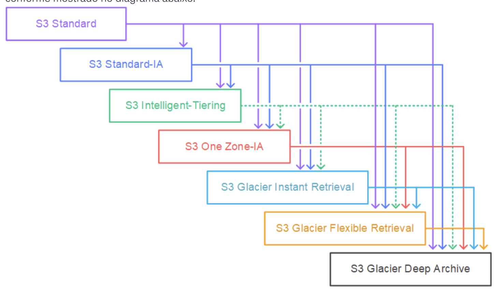

# S3 Glacier — Decorar

## Restore — a tabela

| Classe | Expedited | Standard (com Batch Ops) | Standard (sem) | Bulk |
|---|---|---|---|---|
| **Glacier Flexible Retrieval** | **1-5 min** | Minutos–5 h | **3-5 h** | **5-12 h** |
| **Glacier Deep Archive** | **não disponível** | 9-12 h | **até 12 h** | **até 48 h** |

- **Standard** é o padrão quando nenhum tier é especificado.
- **Bulk é grátis** no Glacier Flexible Retrieval e no Intelligent-Tiering.
- **Standard é grátis** no Intelligent-Tiering.
- **Expedited** é premium, e **não existe** no Deep Archive.

## Expedited — os números

> *"Objects under 250 megabytes in size are typically made available within 1–5 minutes, and objects 250 megabytes or larger ... up to 300 megabytes per second of retrieval throughput."*

**Provisioned capacity** (só Glacier Flexible Retrieval):
> *"Each unit of capacity provides that at least three Expedited retrievals can be performed every 5 minutes, and it provides up to 300 megabytes per second of retrieval throughput."*
Sem ela, *"Expedited retrievals might not be accepted during periods of high demand"*.
⚠️ As unidades são da **conta**, então *"the requester... should purchase the provisioned capacity unit, not the bucket owner"*.

## Mínimos e overhead

| Classe | Mín. dias | Mín. cobrado | AZs | Disponibilidade |
|---|---|---|---|---|
| **Glacier Instant Retrieval** | **90** | **128 KB** | ≥3 | 99,9% |
| **Glacier Flexible Retrieval** | **90** | — | ≥3 | 99,99% (após restore) |
| **Glacier Deep Archive** | **180** | — | ≥3 | 99,99% (após restore) |

**Overhead de arquivo** (Flexible Retrieval e Deep Archive): **40 KB por objeto** — **32 KB** na taxa do Glacier + **8 KB** na taxa do **S3 Standard**.

> [!warning] Objeto pequeno no Deep Archive pode não compensar
> 40 KB de overhead por objeto. Arquivar milhões de objetos de 10 KB custa mais em overhead que em dado.

## Lifecycle — o modelo cascata (waterfall)



Quem **entra** em cada classe de arquivamento:

| Classe | Pode receber de |
|---|---|
| **Glacier Instant Retrieval** | Standard · Standard-IA · Intelligent-Tiering ⚠️ · **(não de One Zone-IA)** |
| **Glacier Flexible Retrieval** | Standard · Standard-IA · Intelligent-Tiering ⚠️ · One Zone-IA · Glacier IR |
| **Glacier Deep Archive** | **todas as classes** |

Para onde cada uma **sai**:

```
Glacier Instant Retrieval ──> Glacier Flexible Retrieval / Deep Archive
Glacier Flexible Retrieval ──> SÓ Deep Archive
Deep Archive ──> SAÍDA NENHUMA (só restore + copy)
```

⚠️ As transições do **Intelligent-Tiering** dependem do access tier em que o objeto está. Ver [[3 - Performance (24%)/S3/2 - Decorar|S3 - Decorar]].

> [!warning] A seta que falta
> **One Zone-IA não transiciona para Glacier Instant Retrieval** — só para **Glacier FR** e **Deep Archive**. Engana porque Glacier IR é a mais "quente" das três de arquivamento.

E o mínimo manda: Glacier IR no dia 4 → Deep Archive só no dia **94**.

## Escala de restore

| Item | Valor |
|---|---|
| Taxa de requisição de restore | **1.000 transações/s** |
| Throughput | *"up to 1–2 petabytes per day per customer account"* |
| Objeto > 5 TB | mais devagar, a até 300 MB/s |
| Exemplo oficial | *"a 50-terabyte S3 Glacier Flexible Retrieval object could take up to 48 hours"* |

## Links

- [[3 - Performance (24%)/S3 Glacier/1 - O que e|1 - O que e]] · [[3 - Performance (24%)/S3 Glacier/3 - Detalhes|3 - Detalhes]] · [[3 - Performance (24%)/S3 Glacier/4 - Questoes|4 - Questoes]]
- [[02 - Numeros para decorar]]
