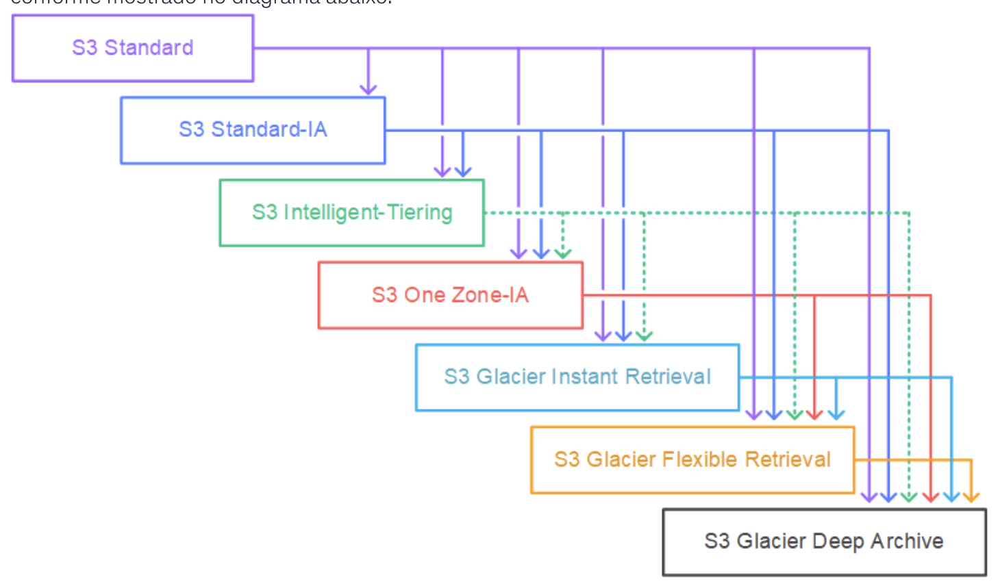

# Amazon S3 — Decorar

> [!important] Esta nota é só número e tabela. Releia na véspera.

## As classes (a tabela mais importante do S3)

| Classe | Disponibilidade | AZs | Mín. dias | Mín. cobrado | Latência |
|---|---|---|---|---|---|
| **Standard** | 99,99% | ≥3 | — | — | ms |
| **Intelligent-Tiering** | 99,9% | ≥3 | — | — | ms |
| **Standard-IA** | 99,9% | ≥3 | **30** | **128 KB** | ms |
| **One Zone-IA** | **99,5%** | **1** | **30** | **128 KB** | ms |
| **Express One Zone** | 99,95% | **1** | — | — | **ms de 1 dígito** |
| **Glacier Instant Retrieval** | 99,9% | ≥3 | **90** | **128 KB** | **ms** |
| **Glacier Flexible Retrieval** | 99,99% (após restore) | ≥3 | **90** | — | min a horas |
| **Glacier Deep Archive** | 99,99% (após restore) | ≥3 | **180** | — | horas |

**Durabilidade: 11 noves em TODAS** (exceto Reduced Redundancy, legado, 99,99%).
**Só One Zone-IA e Express One Zone têm 1 AZ.**

## Restore do Glacier

| Classe | Expedited | Standard | Bulk |
|---|---|---|---|
| **Glacier Flexible Retrieval** | **1-5 min** | **3-5 h** | **5-12 h** (grátis) |
| **Glacier Deep Archive** | **não existe** | **até 12 h** | **até 48 h** |

**Glacier Instant Retrieval não precisa de restore** — é `GET` direto.

## Intelligent-Tiering — as transições

```
Frequent Access (entrada)
   ↓ 30 dias sem acesso
Infrequent Access
   ↓ 90 dias sem acesso
Archive Instant Access
   ↓ (opcional, precisa ativar) mín. 90 dias
Archive Access
   ↓ (opcional) mín. 180 dias
Deep Archive Access
```

Cobra **monitoramento por objeto**, **sem** taxa de retrieval. Objeto **< 128 KB nunca sai** do Frequent Access.

## Lifecycle — o modelo cascata (waterfall)

> *"Amazon S3 supports a waterfall model for transitioning between storage classes."* (o Amazon S3 adota um modelo em cascata para as transições entre classes de armazenamento)

A regra visual: **cada classe só desce**, nunca sobe. E ela pode pular etapas — Standard vai **direto** para Deep Archive se você quiser.



Como ler o diagrama:

- **Cada caixa manda setas para todas as classes abaixo dela** que aceitam a transição. Por isso saem **seis** setas roxas do S3 Standard.
- **As setas verdes tracejadas** (Intelligent-Tiering) são condicionais: dependem do **access tier** em que o objeto está.
- **Repare no que falta**: não há seta vermelha (One Zone-IA) chegando no Glacier Instant Retrieval.
- **Deep Archive recebe de todas** e não manda para ninguém.

### A matriz — de onde para onde

| **De ↓ / Para →** | Std-IA | Int-Tiering | One Zone-IA | Glacier IR | Glacier FR | Deep Archive |
|---|:---:|:---:|:---:|:---:|:---:|:---:|
| **S3 Standard** | ✅ | ✅ | ✅ | ✅ | ✅ | ✅ |
| **S3 Standard-IA** | — | ✅ | ✅ | ✅ | ✅ | ✅ |
| **S3 Intelligent-Tiering** | ❌ | — | ⚠️ | ⚠️ | ⚠️ | ⚠️ |
| **S3 One Zone-IA** | ❌ | ❌ | — | **❌** | ✅ | ✅ |
| **S3 Glacier IR** | ❌ | ❌ | ❌ | — | ✅ | ✅ |
| **S3 Glacier FR** | ❌ | ❌ | ❌ | ❌ | — | ✅ |
| **S3 Glacier Deep Archive** | ❌ | ❌ | ❌ | ❌ | ❌ | — |

⚠️ = permitido, **mas depende do access tier** em que o objeto está (ver abaixo).

### As três linhas que mais caem

| Fato | Detalhe |
|---|---|
| **Standard vai direto para qualquer classe** | Não precisa passar por IA. Pode ir de Standard a Deep Archive numa regra só |
| **One Zone-IA NÃO vai para Glacier Instant Retrieval** | Só para **Glacier FR** e **Deep Archive**. É a seta que falta no diagrama |
| **Deep Archive não tem saída** | *"You cannot use an S3 Lifecycle configuration rule to convert the storage class of an object from S3 Glacier Deep Archive to any other storage class."* (não é possível usar uma regra de lifecycle do S3 para converter a classe de um objeto que está no S3 Glacier Deep Archive para qualquer outra classe) Para sair: **restore** + **copy** |

### Por que as setas do Intelligent-Tiering são tracejadas

Porque a transição depende de **em qual access tier** o objeto está naquele momento:

| Access tier atual | Pode transicionar para |
|---|---|
| **Frequent Access** ou **Infrequent Access** | One Zone-IA · Glacier IR · Glacier FR · Deep Archive |
| **Archive Instant Access** | Glacier IR · Glacier FR · Deep Archive |
| **Archive Access** | Glacier FR · Deep Archive |
| **Deep Archive Access** | **só** Deep Archive |

Ou seja: quanto mais frio o tier interno, **menos destinos** restam. O waterfall vale também **dentro** do Intelligent-Tiering.

### As duas regras que invalidam uma regra de lifecycle

**1. Respeita o mínimo da classe atual.** *"You can't create a single Lifecycle rule that transitions objects from one storage class to another before the minimum storage duration period has passed."* (não é possível criar uma única regra de lifecycle que transicione objetos de uma classe para outra antes de cumprido o período mínimo de armazenamento)
O exemplo da própria doc: Glacier IR (mínimo **90 dias**) no dia 4 → Deep Archive só a partir do dia **94**.
*"You can specify two rules to accomplish this, but you pay the minimum duration storage charges."* (você pode usar duas regras para conseguir isso, mas paga as cobranças de duração mínima de armazenamento)

**2. Objeto menor que 128 KB não transiciona por padrão.** *"Amazon S3 applies a default behavior to S3 Lifecycle configurations that prevents objects smaller than 128 KB from being transitioned to any storage class."* O motivo é econômico: *"you are charged a transition request for each object"*.
Para forçar: filtro `ObjectSizeGreaterThan` / `ObjectSizeLessThan`, ou o header `x-amz-transition-default-minimum-object-size`.
⚠️ Antes de **setembro de 2024** o padrão permitia objetos < 128 KB irem para **Glacier FR e Deep Archive**. Configurações antigas mantêm o comportamento velho até serem modificadas.

## Performance

| Item | Valor |
|---|---|
| Requisições **por prefixo** | **3.500** PUT/COPY/POST/DELETE · **5.500** GET/HEAD por segundo |
| Prefixos por bucket | **ilimitados** (10 prefixos = 55.000 leituras/s) |
| Objeto máximo | **48,8 TiB** |
| Multipart: usar a partir de | **100 MB** |
| Multipart: tamanho da parte | **5 MiB a 5 GiB** |
| Multipart: máximo de partes | **10.000** |
| Latência típica | **100-200 ms** |
| Erro de excesso de requisição | **503 Slow Down** |

## Criptografia — o que cada opção faz

| Opção | Quem gerencia a chave | Quem criptografa | Auditoria do uso da chave | Quando usar |
|---|---|---|---|---|
| **SSE-S3** | A **AWS**, de forma transparente (chave gerenciada pelo S3) | O **S3**, no servidor | **Não** (a chave não é sua, não aparece no CloudTrail como uso de chave) | Criptografia básica, sem requisito especial — **é o padrão** desde 05/01/2023 |
| **SSE-KMS** | **KMS**, com **controle seu** (key policy, rotação, desabilitar) | O **S3**, no servidor | **Sim** — cada `Decrypt` aparece no **CloudTrail** | Precisa de **controle de acesso à chave**, **auditoria**, **compliance** ou **compartilhar entre contas** |
| **DSSE-KMS** | **KMS**, em **duas camadas** de criptografia | O **S3**, no servidor (duas vezes) | **Sim** | Requisito **regulatório de criptografia dupla** (ex.: certos contratos do setor público) |
| **SSE-C** | **Você** — manda a chave **em cada requisição** (HTTPS obrigatório) | O **S3**, no servidor, com a **sua** chave (e **descarta** depois) | **Por sua conta** | A chave **não pode ficar armazenada na AWS**, mas você aceita que o S3 faça a cifragem |
| **Client-side (CSE)** | **Você** | **Sua aplicação**, antes de enviar | **Por sua conta** | **Nem a AWS** pode ver o dado em claro em nenhum momento |

### Os detalhes que viram pegadinha

| Item | Detalhe |
|---|---|
| **SSE-C** | **Não pode** ser criptografia padrão do bucket. Se você perder a chave, **o objeto é irrecuperável** — a AWS não guarda nenhuma cópia |
| **SSE-KMS + muitos objetos** | Cada operação chama a KMS → custo e **quota de requisições**. Habilite **S3 Bucket Keys**: reduz drasticamente as chamadas |
| **Compartilhar entre contas** | Só com **customer managed key** no SSE-KMS. Com a chave `aws/s3` (AWS managed) **não dá** |
| **Mudar a criptografia depois** | A configuração vale para objetos **novos**. Para os antigos: **copiar o objeto sobre si mesmo** ou usar **S3 Batch Operations** |
| **Em repouso × em trânsito** | Todas as opções acima são **em repouso**. Para **em trânsito**: bucket policy negando quando `aws:SecureTransport` é `false` |

> [!tip] Como a prova sinaliza cada uma
> *"sem requisitos especiais"* → **SSE-S3** · *"auditar/controlar/rotacionar a chave"*, *"outra conta"* → **SSE-KMS** · *"dupla camada"* → **DSSE-KMS** · *"a chave não pode ficar na AWS"* → **SSE-C** · *"a AWS nunca pode ver o dado em claro"* → **client-side**.

## Proteção de dados

| Recurso | Número / regra |
|---|---|
| Versionamento | 3 estados: Unversioned → **Enabled** (nunca volta) → Suspended |
| Object Lock | **Exige versionamento**. **Compliance** = nem o root apaga. **Governance** = só com `s3:BypassGovernanceRetention` |
| Legal hold | **Não expira**. Removido manualmente |
| Block Public Access | **4 flags**: `BlockPublicAcls`, `IgnorePublicAcls`, `BlockPublicPolicy`, `RestrictPublicBuckets`. **Vence a bucket policy** |
| Replicação | **Assíncrona**. Versionamento **nos dois** buckets. **Não** replica o acervo antigo (use **Batch Replication**) |
| S3 RTC | *"99.9 percent of those objects within 15 minutes"* (99,9% desses objetos em até 15 minutos) |
| Overhead de arquivo (Glacier FR/Deep Archive) | **40 KB** por objeto: 32 KB na taxa do Glacier + 8 KB na do Standard |

## Links

- [[3 - Performance (24%)/S3/1 - O que e|1 - O que e]] · [[3 - Performance (24%)/S3/3 - Detalhes|3 - Detalhes]] · [[3 - Performance (24%)/S3/4 - Questoes|4 - Questoes]]
- [[02 - Numeros para decorar]]
