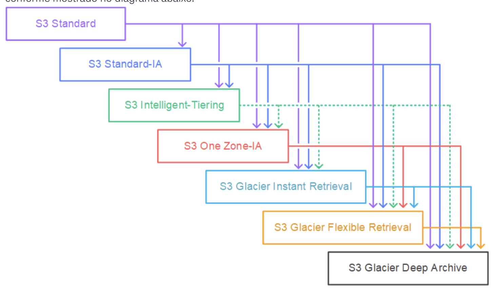

# Amazon S3 — Detalhes

## 1. Escolhendo a classe

A decisão depende de **três** perguntas, nesta ordem:

**Com que frequência o objeto é lido?**
- Mais de uma vez por mês → **Standard**
- Cerca de uma vez por mês → **Standard-IA**
- Cerca de uma vez por trimestre → **Glacier Instant Retrieval**
- Cerca de uma vez por ano → **Glacier Flexible Retrieval**
- Menos de uma vez por ano → **Glacier Deep Archive**

**Qual latência é aceitável quando ele for lido?**
- Milissegundos → Standard, IA, One Zone-IA, **Glacier Instant Retrieval**
- Minutos a horas → Glacier Flexible Retrieval
- Horas → Deep Archive

**O dado é reproduzível?**
- Sim (thumbnail, cache, resultado recalculável) → **One Zone-IA** economiza ~20% sobre o IA
- Não → nunca One Zone

> [!warning] One Zone-IA é a armadilha mais frequente do S3
> A documentação é explícita: *"Not resilient to the loss of the Availability Zone."* (não é resiliente à perda da Zona de Disponibilidade) Se o enunciado disser **highly available**, **critical**, **compliance** ou **production**, One Zone-IA está errado — mesmo sendo o mais barato entre os IA.

### Quando Intelligent-Tiering **não** é econômico

1. **Padrão de acesso conhecido** — a taxa de monitoramento por objeto vira desperdício.
2. **Muitos objetos pequenos** — a taxa é **por objeto**, e objeto abaixo de 128 KB *"is not monitored and not eligible for auto-tiering"*, ficando eternamente no Frequent Access (o tier mais caro).
3. **Dado que já nasce frio** — vá direto para a classe de arquivo.

## 2. Lifecycle

O lifecycle move ou apaga objetos automaticamente por idade. Duas regras governam tudo:

**Regra 1 — é um modelo cascata (waterfall), só de quente para frio.** A doc é explícita: *"Amazon S3 supports a waterfall model for transitioning between storage classes."* (o Amazon S3 adota um modelo em cascata para as transições entre classes de armazenamento)

Cada classe desce na lista e **pode pular etapas** — mas nunca sobe. O que é permitido, classe por classe (texto oficial):

| De | Pode ir para |
|---|---|
| **S3 Standard** | *"the S3 Standard-IA, S3 Intelligent-Tiering, S3 One Zone-IA, S3 Glacier Instant Retrieval, S3 Glacier Flexible Retrieval, or S3 Glacier Deep Archive"* (o S3 Standard-IA, o S3 Intelligent-Tiering, o S3 One Zone-IA, o S3 Glacier Instant Retrieval, o S3 Glacier Flexible Retrieval ou o S3 Glacier Deep Archive) — **todas** |
| **S3 Standard-IA** | *"the S3 Intelligent-Tiering, S3 One Zone-IA, S3 Glacier Instant Retrieval, S3 Glacier Flexible Retrieval, or S3 Glacier Deep Archive"* |
| **S3 Intelligent-Tiering** | depende do **access tier** — ver abaixo |
| **S3 One Zone-IA** | *"the S3 Glacier Flexible Retrieval or S3 Glacier Deep Archive"* (o S3 Glacier Flexible Retrieval ou o S3 Glacier Deep Archive) — **note que Glacier Instant Retrieval não está na lista** |
| **S3 Glacier Instant Retrieval** | *"the S3 Glacier Flexible Retrieval or S3 Glacier Deep Archive"* (o S3 Glacier Flexible Retrieval ou o S3 Glacier Deep Archive) |
| **S3 Glacier Flexible Retrieval** | **só** Deep Archive |
| **S3 Glacier Deep Archive** | **nenhuma** |

> [!important] Os três pontos que a prova explora nessa tabela
> **1. Standard vai direto para qualquer classe.** Não existe obrigação de passar por Standard-IA. Uma única regra pode levar de Standard a Deep Archive.
> **2. One Zone-IA NÃO transiciona para Glacier Instant Retrieval.** É a única "seta faltando" no meio do diagrama, e é fácil de errar porque Glacier IR é mais quente que Glacier FR — parece que deveria dar.
> **3. Nada volta.** Para "esquentar" um objeto você precisa de **restore** (nas classes de arquivo) seguido de **copy** — a doc diz: *"you must use the restore operation to make a temporary copy of the object first. Then use the copy operation..."*. Isso é uma operação sua, não lifecycle.

#### Por que as setas do Intelligent-Tiering aparecem tracejadas no diagrama da AWS

Porque a transição para fora dele **depende do access tier interno** em que o objeto está naquele momento:

| Access tier atual | Destinos possíveis |
|---|---|
| **Frequent Access** ou **Infrequent Access** | One Zone-IA · Glacier IR · Glacier FR · Deep Archive |
| **Archive Instant Access** | Glacier IR · Glacier FR · Deep Archive |
| **Archive Access** | Glacier FR · Deep Archive |
| **Deep Archive Access** | **só** Deep Archive |

O waterfall, portanto, vale **duas vezes**: entre classes, e dentro do Intelligent-Tiering. Quanto mais frio o tier interno, menos destinos sobram.

E uma ressalva de replicação que vale anotar: *"For versioning enabled or versioning suspended buckets, you can't transition objects with a `Pending` or `Failed` replication status."* (em buckets com versionamento habilitado ou suspenso, não é possível transicionar objetos com status de replicação `Pending` ou `Failed`)

Fechando a regra 1 — Glacier Flexible Retrieval transiciona **apenas** para Deep Archive: *"Objects that are stored in the S3 Glacier Flexible Retrieval storage class can only be transitioned to the S3 Glacier Deep Archive storage class."* (objetos armazenados na classe S3 Glacier Flexible Retrieval só podem ser transicionados para o S3 Glacier Deep Archive) E de Deep Archive **não sai**: *"You cannot use an S3 Lifecycle configuration rule to convert the storage class of an object from S3 Glacier Deep Archive to any other storage class."* (não é possível usar uma regra de lifecycle do S3 para converter a classe de um objeto que está no S3 Glacier Deep Archive para qualquer outra classe)

**Regra 2 — respeita o mínimo da classe atual.** *"You can't create a single Lifecycle rule that transitions objects from one storage class to another before the minimum storage duration period has passed."* (não é possível criar uma única regra de lifecycle que transicione objetos de uma classe para outra antes de cumprido o período mínimo de armazenamento) O exemplo da própria doc: objeto que foi para Glacier IR no dia 4 só pode ir para Deep Archive no dia **94** (4 + 90).

### Objetos pequenos

Desde setembro de 2024, *"Objects smaller than 128 KB will not transition by default to any storage class"* (objetos menores que 128 KB não transicionam, por padrão, para nenhuma classe de armazenamento). Para forçar, use filtro de tamanho (`ObjectSizeGreaterThan` / `ObjectSizeLessThan`) ou o header `x-amz-transition-default-minimum-object-size`.

E atenção: *"you are charged a transition request for each object"* (você é cobrado por uma requisição de transição para cada objeto) — mover milhões de objetos minúsculos pode custar mais do que a economia.

### Ações esquecidas que economizam muito

| Ação | O que evita |
|---|---|
| `AbortIncompleteMultipartUpload` | Upload multipart inacabado **continua sendo cobrado** até ser completado ou abortado, e não aparece na listagem normal |
| `NoncurrentVersionExpiration` | Versões antigas acumulando — **cada versão é um objeto cobrado** |
| `ExpiredObjectDeleteMarker` | Delete markers órfãos |

> [!tip] A regra que todo bucket deveria ter
> `AbortIncompleteMultipartUpload` depois de 7 dias. É custo invisível puro.

## 3. Performance

O S3 escala por **prefixo**: *"your application can achieve at least 3,500 PUT/COPY/POST/DELETE or 5,500 GET/HEAD requests per second per partitioned Amazon S3 prefix"*, e *"There are no limits to the number of prefixes in a bucket"* (não há limite para a quantidade de prefixos num bucket).

Consequência prática: 10 prefixos de leitura = **55.000 requisições por segundo**. Se a aplicação recebe **503 Slow Down**, a resposta é **distribuir as chaves em mais prefixos** e aplicar retry com backoff — não "pedir aumento de limite".

O escalonamento *"happens gradually and is not instantaneous"*, então os 503 aparecem durante a subida.

**Multipart upload**: recomendado a partir de **100 MB**; partes de **5 MiB a 5 GiB** (a última parte não tem mínimo); até **10.000** partes. As partes podem subir em paralelo e fora de ordem — é o que dá throughput.

**Transfer Acceleration**: usa a borda do CloudFront para **upload**. A doc diz para usar quando *"Your customers upload to a centralized general purpose bucket from all over the world"* (seus clientes fazem upload para um bucket central de uso geral, do mundo inteiro), quando você transfere *"gigabytes to terabytes of data on a regular basis across continents"*, ou quando *"You can't use all of your available bandwidth over the internet"* (você não consegue aproveitar toda a sua banda disponível pela internet). Requer nome de bucket sem ponto, e o efeito pode levar *"up to 20 minutes"* para aparecer.

Para centenas de milhares de requisições por segundo com latência de **único dígito de milissegundo**, a classe indicada é **S3 Express One Zone** (*"up to 10x faster and with request costs 50 percent lower than S3 Standard"*).

## 4. Criptografia

Desde 5 de janeiro de 2023, *"all new object uploads to Amazon S3 are automatically encrypted at no additional cost and with no impact on performance"* com **SSE-S3**. Ou seja: **não existe objeto novo sem criptografia no S3**.

Pontos que a prova explora:

- **Mudar o default do bucket não recriptografa o acervo.** Só vale para objetos novos. Para os antigos: **S3 Batch Operations (Copy)** ou `CopyObject`.
- **Cross-account com SSE-KMS exige chave customer managed.** *"If you want to grant cross-account access to your S3 objects, use a customer managed key."* (se você quer conceder acesso entre contas aos seus objetos do S3, use uma customer managed key) Se você não especificar a chave, o S3 usa a AWS managed key `aws/s3`, que não pode ser compartilhada.
- **Replicação preserva o tipo de criptografia da origem**: *"the replicas use the same type of encryption as the source objects. The default encryption settings of the destination bucket are not used."*
- **Bucket de log de acesso precisa ser SSE-S3**: *"the bucket must use Amazon S3 managed keys (SSE-S3)"*.
- **S3 Bucket Keys**: a KMS gera uma chave no nível do bucket, usada por um período limitado dentro do S3, o que *"decrease[s] the number of transactions from Amazon S3 to AWS KMS to reduce the cost of SSE-KMS"*.

## 5. Versionamento, Object Lock e Block Public Access

**Versionamento** tem três estados: Unversioned (padrão), Enabled e Suspended. A regra crítica: *"After you version-enable a bucket, it can never return to an unversioned state. But you can suspend versioning."* (depois que você habilita o versionamento num bucket, ele nunca volta ao estado sem versionamento — mas você pode suspendê-lo) Objetos anteriores ficam com version ID `null`. Um `DELETE` simples insere um **delete marker** em vez de apagar.

**Object Lock** implementa WORM e *"works only in buckets that have S3 Versioning enabled"*. Dois mecanismos independentes:

- **Retention period** em modo **Compliance** — *"can't be overwritten or deleted by any user, including the root user in your AWS account"*. O período não encurta. *"The only way to delete an object under the compliance mode before its retention date expires is to delete the associated AWS account."* (a única forma de apagar um objeto em modo compliance antes do fim da retenção é encerrar a conta AWS associada)
- **Retention period** em modo **Governance** — quem tiver `s3:BypassGovernanceRetention` **e** enviar `x-amz-bypass-governance-retention:true` consegue apagar.
- **Legal hold** — *"has no expiration date... remains in place until you explicitly remove it"*.

**Block Public Access** tem quatro flags independentes e é avaliado assim: *"S3 applies the most restrictive combination"* (o S3 aplica a combinação mais restritiva) entre access point, bucket e conta. Pode ser aplicado no nível de **organização** (as quatro juntas), conta, bucket ou access point. Não altera policies nem ACLs existentes — apenas neutraliza o efeito público delas.

## 6. Replicação

*"automatic, asynchronous copying of objects across Amazon S3 buckets"* — **CRR** (regiões diferentes) e **SRR** (mesma região).

| Fato | Detalhe |
|---|---|
| Versionamento | *"Both source and destination buckets must have versioning enabled"* (os buckets de origem e de destino precisam ter versionamento habilitado) |
| Acervo existente | **Não** é replicado. Use **S3 Batch Replication** (que também recobre objetos que **falharam**) |
| Bidirecional | Suportado, com *replica modification sync* para metadados |
| SLA | **S3 RTC**: *"99.9 percent of those objects within 15 minutes"* (99,9% desses objetos em até 15 minutos) |
| Object Lock | Se a origem tem, o destino **precisa** ter |
| Destino | **Não** pode ser bucket com Requester Pays |

> [!warning] Replicação não é backup
> Replicação propaga mudanças, inclusive exclusões lógicas se você habilitar delete marker replication. Contra ransomware e erro humano, use **versionamento + Object Lock + MFA Delete**.

## 7. Outros recursos

| Recurso | Para quê |
|---|---|
| **Access Points** | Endpoint nomeado por aplicação, com policy e BPA próprios. Evita bucket policy gigante |
| **Bucket owner enforced** (Object Ownership) | Desativa ACLs. **Pré-requisito do OAC do CloudFront** |
| **Requester Pays** | *"the requester pays the cost of the request and the data download"*; *"The bucket owner always pays the cost of storing data"* (o dono do bucket sempre paga o custo de armazenar os dados). ⚠️ **Proíbe acesso anônimo** |
| **Storage Class Analysis** | *"analyze storage access patterns to help you decide when to transition"*. ⚠️ Só recomenda **Standard → Standard-IA**, e precisa de **30 dias ou mais** |
| **Storage Lens** | Painel de uso e atividade, com recomendações, em toda a organização |
| **Site estático** | Website endpoint. ⚠️ Com CloudFront, vira *custom origin* e **não** aceita OAC/OAI |

## Links

- [[3 - Performance (24%)/S3/1 - O que e|1 - O que e]] · [[3 - Performance (24%)/S3/2 - Decorar|2 - Decorar]] · [[3 - Performance (24%)/S3/4 - Questoes|4 - Questoes]]
- [[9 - Fundamentos e apoio/Criptografia em repouso e em transito/1 - O que e|Criptografia em repouso e em transito]] · [[1 - Seguranca (30%)/KMS/1 - O que e|KMS]] · [[3 - Performance (24%)/CloudFront/1 - O que e|CloudFront]] · [[3 - Performance (24%)/S3 Glacier/1 - O que e|S3 Glacier]]
- [Classes de armazenamento](https://docs.aws.amazon.com/AmazonS3/latest/userguide/storage-class-intro.html)
- [Transições de lifecycle](https://docs.aws.amazon.com/AmazonS3/latest/userguide/lifecycle-transition-general-considerations.html)
